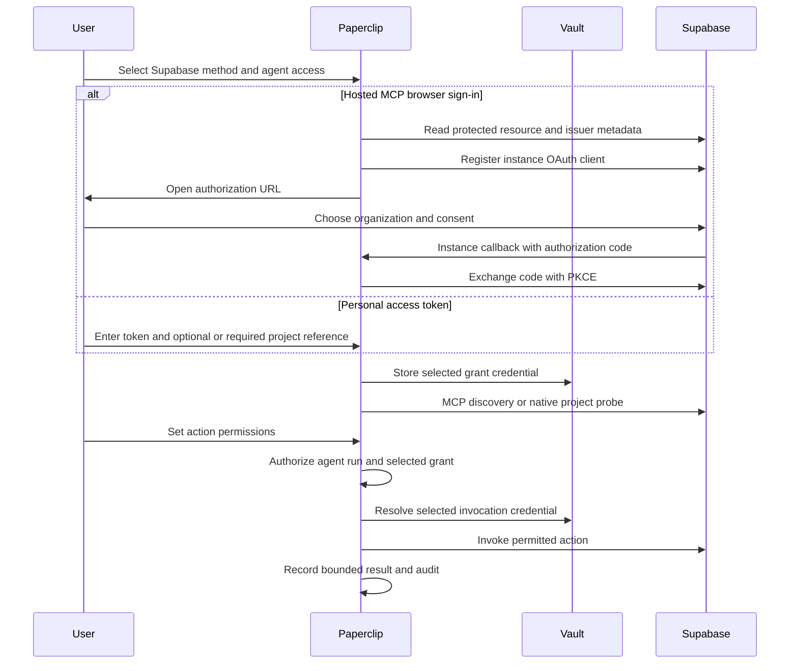

# Supabase

Reviewed 2026-10-22. Paperclip agents can deploy Supabase Edge Functions and
configure application Auth and the Data API through a governed native Management
API connection. Hosted MCP supplies project creation, database migrations and
other provider tools. These are distinct connection methods and credentials are
never forwarded from MCP OAuth into the Management API.

Neither Paperclip ID nor Paperclip Connect participates. OAuth discovery,
registration, credentials and callbacks are instance-local. Cloud and self-hosted
instances use the same path and the normal connection vault, grants, policies,
run gateway and audit.

## Methods and capability boundary

| Method | Authentication | Capabilities | Scope |
| --- | --- | --- | --- |
| `mcp-oauth` | Supabase browser consent and DCR | Provider MCP project/account, SQL/migration, Edge Function, branching and optional storage tools | Consented organization, optionally pinned project |
| `mcp-api-key` | Supabase personal access token | Same hosted MCP tool surface, limited by token permissions | Token authorization, optionally pinned project |
| `management-api` | Supabase personal access token | Eleven reviewed project/configuration/function actions below | Required saved project reference |

For MCP, **Pin to project reference** is optional under Advanced. An unpinned
connection can create projects. Supplying `project_ref` disables account tools,
including project creation. The read-only option stays under Advanced and
defaults off. The optional feature-group list accepts `docs`, `account`,
`database`, `debugging`, `development`, `functions`, `branching`, and `storage`.
Storage requires explicit selection. Existing saved project pins are preserved.
See the [official MCP configuration and tool list](https://supabase.com/docs/guides/ai-tools/mcp).

Native actions use these fixed paths under `https://api.supabase.com/v1`:

| Action | Request | Risk |
| --- | --- | --- |
| `supabase_get_project` | `GET /projects/{savedRef}` | Read |
| `supabase_get_auth_config` | `GET /projects/{savedRef}/config/auth` | Read |
| `supabase_update_auth_config` | `PATCH /projects/{savedRef}/config/auth` | Write |
| `supabase_get_api_config` | `GET /projects/{savedRef}/postgrest` | Read |
| `supabase_update_api_config` | `PATCH /projects/{savedRef}/postgrest` | Write |
| `supabase_list_edge_functions` | `GET /projects/{savedRef}/functions` | Read |
| `supabase_get_edge_function` | `GET /projects/{savedRef}/functions/{slug}` | Read |
| `supabase_deploy_edge_function` | `POST /projects/{savedRef}/functions/deploy?slug={slug}` | Write |
| `supabase_delete_edge_function` | `DELETE /projects/{savedRef}/functions/{slug}` | Destructive |
| `supabase_list_edge_function_secrets` | `GET /projects/{savedRef}/secrets` | Read |
| `supabase_upsert_edge_function_secret` | `POST /projects/{savedRef}/secrets` | Write |

Auth configuration includes `site_url`, `uri_allow_list`, `disable_signup`,
`external_email_enabled`, `mailer_autoconfirm`, `jwt_exp`, and
`password_min_length`. Data API configuration includes `db_schema`,
`db_extra_search_path`, `max_rows`, `db_pool`, and
`db_pool_acquisition_timeout`. Unknown fields and empty updates are rejected.
Reads and write responses expose only these non-secret fields. In particular,
Auth provider client secrets, SMTP passwords and PostgREST signing secrets are
not returned. See the official [Auth configuration](https://supabase.com/docs/reference/api/v1-update-auth-service-config)
and [Data API configuration](https://supabase.com/docs/reference/api/v1-update-postgrest-service-config)
contracts.

Deployment sends UTF-8 source files as multipart `file` parts with a `metadata`
part, matching the [deployment endpoint](https://supabase.com/docs/reference/api/v1-deploy-a-function)
and [provider deployment example](https://supabase.com/changelog/33720-deploy-and-update-edge-functions-using-the-management-api).
The supplied entrypoint and optional import map must exist among unique relative
file names. JWT verification defaults on; callers can explicitly disable it for
an application that handles authentication itself. The request is bounded to
2 MiB and 50 files. The connector never reads server filesystem paths, runs a
shell, or executes source code in Paperclip.

Native REST lists Edge Function secret names and update times and accepts
`{name, secretValue}` to create or replace one environment secret. Secret values
are never read back. Gateway argument summaries redact `secretValue`, and the
provider response is discarded on writes. Each value is bounded to 64 KiB.
See [secret writes](https://supabase.com/docs/reference/api/v1-bulk-create-secrets)
and [secret inventory](https://supabase.com/docs/reference/api/v1-list-all-secrets).
Use the Dashboard when a human needs private entry; this action accepts a value
the agent already has authority to use.

Native REST does not expose raw SQL, project creation, database credentials,
SMTP passwords or OAuth client secrets. Use MCP for project creation and
migrations. MCP Edge Function secret entry depends on provider and
client URL elicitation support; this connector change does not claim that flow
is qualified. Branching and other paid provider features retain Supabase's
entitlements and cost handling.

## Connection flow

The editable diagram is also in [supabase-flow.mmd](./supabase-flow.mmd).
Public metadata observed on 2026-10-22 advertised:

- MCP: `https://mcp.supabase.com/mcp`
- Protected resource: `https://mcp.supabase.com/.well-known/oauth-protected-resource/mcp`
- Issuer metadata: `https://api.supabase.com/.well-known/oauth-authorization-server`
- Authorization: `https://api.supabase.com/v1/oauth/authorize`
- Token: `https://api.supabase.com/v1/oauth/token`
- DCR: `https://api.supabase.com/platform/oauth/apps/register`
- Paperclip callback: `<instance-origin>/api/tools/oauth/callback`

The existing thirteen reviewed MCP scopes match the public metadata. Native PAT
permissions are separate: `project_admin_read`, `edge_functions_read`,
`edge_functions_write`, `auth_config_read`, `auth_config_write`,
`project_admin_write` for Auth changes, `data_api_config_read`, and
`data_api_config_write`, plus `edge_functions_secrets_read/write` for function
secrets. Equivalent endpoint OAuth scopes are `projects:read`,
`edge_functions:read/write`, `secrets:read/write`, `auth:read/write`, and `rest:read/write`, but the
native method uses a PAT. Permissions remain authoritative at Supabase. See
[project access](https://supabase.com/docs/reference/api/v1-get-project),
[function access](https://supabase.com/docs/reference/api/v1-list-all-functions),
[Auth access](https://supabase.com/docs/reference/api/v1-get-auth-service-config),
and [Data API access](https://supabase.com/docs/reference/api/v1-get-postgrest-service-config).

## Administrator setup and verification

1. Open Apps → Supabase, choose the connection identity and agents, then choose
   the method. Browser sign-in requires no manually registered OAuth app.
2. For token methods, create a scoped PAT in
   [Supabase access tokens](https://supabase.com/dashboard/account/tokens) with
   permissions for the intended actions. A project publishable, anon,
   `service_role`, or secret API key cannot replace this PAT.
3. For native deployment/configuration, copy the existing project's reference
   from Project Settings. The saved reference is the execution boundary and
   cannot be overridden by tool arguments. For MCP project creation, leave the
   Advanced project pin empty and retain the account feature group.
4. Complete consent or token setup. For browser consent, honor provider delays
   and real pointer/keyboard interaction before diagnosing an OAuth problem.
   A disabled consent button alone is not evidence of callback failure.
5. On Permissions, inspect discovered actions and set Allowed, Ask first or Off.
   Test project/function inspection, then deploy a disposable function in a
   development project, read its version, and delete it. To verify Auth changes,
   preserve the prior site URL and restore it after a test change.
6. Verify an agent read/write through its run gateway, denial under an Off
   policy, catalog refresh/reconnect, and removal. Confirm the token is absent
   from responses and audit. Provider errors are mapped to fixed messages;
   401/403 require checking token permissions, 402 requires account/billing
   action, and 429 requires waiting. Writes are never automatically retried
   after an uncertain transport result.

## Evidence and remaining qualification

The provider fixture suite is
`server/src/services/connectors/supabase/index.test.ts`. It covers multipart
deployment, configuration, credential/header projection, project containment,
malformed paths/files, schema and risk drift, deletion, secret input summary and output redaction,
provider failures, bounded reads and uncertain-write behavior. Shared connection
tests cover the vault and governed run gateway. Fixtures do not establish
provider account authorization.

Public metadata preflight passed on 2026-10-22, without credentials or client
registration. No Supabase credential was available for this task. Account-bound
OAuth/PAT consent, deployment/configuration, refresh/revoke, and real provider
agent-run proof remain unrun. No paid or production resource was created or
modified. The permission review records retain `liveProof: not-run`.

Sensitive tool arguments such as `secretValue` are encrypted in newly created
approval payloads with the instance tool-action signing secret. Approval summaries
and audit still use redacted values. Existing signed approval records remain
readable and are not rewritten; back up the instance signing key with the database.
